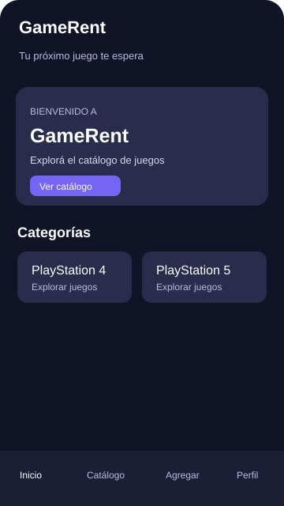
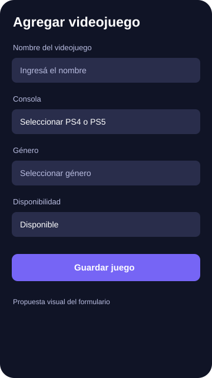
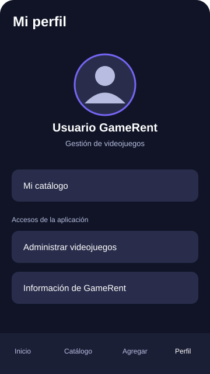

# GameRent 🎮

Aplicación móvil desarrollada en Kotlin con Jetpack Compose para consultar y gestionar un catálogo de videojuegos de PlayStation 4 y PlayStation 5.

## Objetivo

Facilitar la consulta y administración de videojuegos mediante una interfaz sencilla, organizada y fácil de utilizar.

## Funcionalidades

- **Catálogo:** visualizar los videojuegos disponibles.
- **Búsqueda:** encontrar videojuegos por nombre.
- **Filtros:** filtrar el catálogo por consola.
- **CRUD:** agregar, consultar, editar y eliminar videojuegos.
- **Confirmación:** mostrar diálogos antes de confirmar acciones importantes.
- **Interfaz:** navegación entre Inicio, Catálogo, Agregar y Perfil.

## Tecnologías

- Kotlin
- Android Studio
- Jetpack Compose
- Material Design

## Mockups de interfaz

Las siguientes imágenes representan una propuesta visual de las pantallas principales de GameRent.

### Inicio

### Catálogo

### Agregar videojuego

### Perfil

## Estado del proyecto

El catálogo, la búsqueda, los filtros por consola y las operaciones básicas de gestión están implementados. La persistencia de datos y las funciones de cámara, galería y mapas deben verificarse o desarrollarse según los requisitos de la asignación.

## Instalación

1. Clonar el repositorio.
2. Abrir el proyecto desde Android Studio.
3. Esperar a que Gradle sincronice las dependencias.
4. Ejecutar la aplicación en un emulador o dispositivo Android compatible.

## Repositorio

https://github.com/llolo12/GameRent

## Autor

Proyecto académico individual.
